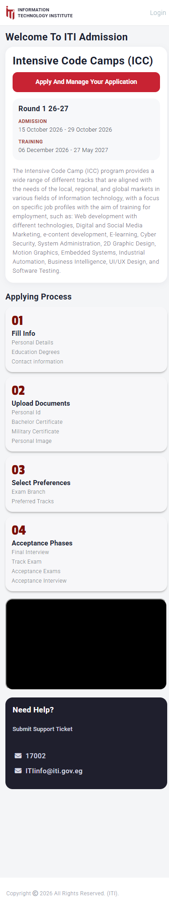
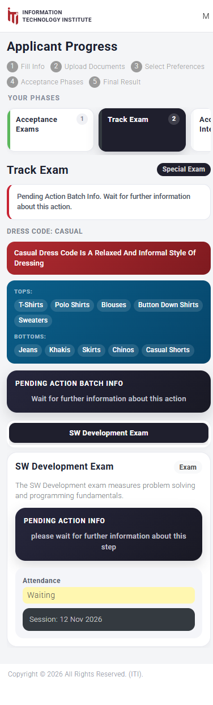
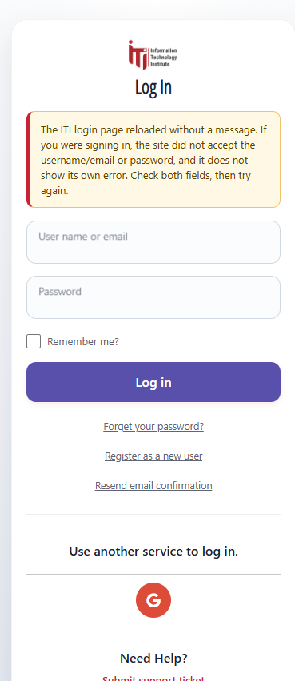

# ITI Companion


**An unofficial Android companion for ITI applicants.** It unblocks the desktop-only
admission portal, makes it readable on a phone, and adds a native dashboard with your current
phase, the next exam, a countdown and local reminders.

[](LICENSE)


> **Not affiliated with the Information Technology Institute (ITI).** This is a
> community-built helper, not an official ITI product. Your credentials are typed only on
> `identity.iti.gov.eg`, inside the app's embedded browser. The app never sees, stores or
> transmits your password.

---

## Why this exists

The ITI applicant portal (`internal.iti.gov.eg`) is built for desktop browsers:

- On a phone it shows a full-screen **"Sorry, please open from PC"** overlay instead of the
  site.
- Once unblocked, the layout assumes a 24 rem sidebar, a clipped five-step strip and a 9/3
  progress grid, so cards, tables and the login form overflow or become unreadable.
- A rejected login re-renders the login page **with no error message**, so a wrong password
  looks like a silent refresh.

ITI Companion keeps the real site and its real origin (cookies, OIDC redirects, uploads and
CORS all keep working) and fixes the presentation on phone-width screens. Everything else is
read-only: a small observer copies a fixed allowlist of API responses into a native summary.
No passwords, no cookies, no raw JSON stored.

---

## Screenshots

| Portal home at 384 px                                                                  | Acceptance phases                                                                                |
| -------------------------------------------------------------------------------------- | ------------------------------------------------------------------------------------------------ |
| [](docs/screenshots/webview-home.png) | [](docs/screenshots/webview-progress.png) |

| Login page                                                                              |
| --------------------------------------------------------------------------------------- |
| [](docs/screenshots/webview-login.png) |

The progress screenshot is a DOM replica of the authenticated page (the real one requires an
applicant login). The login screenshot shows the extra notice the app adds when the site
hides a failed sign-in.

---

## Features

- **Unblocked, mobile-first portal.** Hides the "open from PC" gate and applies a phone
  stylesheet: full-width header, no sidebar, a swipeable phase rail, readable exam and
  interview cards, and a login form that fits the screen.
- **Native dashboard.** Current phase and status, next exam with a live countdown, location,
  date and a progress list.
- **Local exam reminders.** 24 hours and 2 hours before each captured session. Scheduled on
  the device, so they work offline.
- **Offline snapshot.** The phase, exam dates and progress list are cached in Android's
  secure storage. Raw API responses are never persisted.
- **Silent login failures explained.** When the identity server rejects a sign-in without a
  message, the app notices the round-trip and shows an inline notice.
- **Diagnostics.** A self-check reports whether the phone stylesheet actually reached the
  WebView (`iti-app` marker, injected stylesheet, root font).
- **Free forever.** No ads, no subscription, no account, no analytics. Optional tips only.

---

## Requirements

- Android 8.0 or newer.
- Node.js 20+ and npm.
- One of:
  - **EAS Build** (cloud, no Android SDK needed) — recommended for producing the APK.
  - **Android Studio** with SDK 36 and build tools for a local build.
- Expo Go for a quick JS-only preview. Local notifications need a development build or a
  release APK.

---

## Quick start

```bash
git clone https://github.com/Y0ung-Phara0h/iti-companion.git
cd iti-companion/app
npm install            # add --legacy-peer-deps if npm reports a peer conflict
npx expo start
```

Scan the QR code with Expo Go or press `a` for an emulator/device. The WebView and the
injection work in Expo Go; notification scheduling is best tested in a development or
production build.

> After changing `injected.ts` or `mobile-css.ts`, shake the device and reload Expo Go, then
> reopen the Application tab. The WebView keeps the old page until it is reloaded.

### Build the APK

```bash
cd app
npx eas-cli@latest login
npx eas-cli@latest build -p android --profile preview
```

The `preview` profile in `eas.json` produces an installable APK.

---

## How it works

1. **Location:** `src/app/(tabs)/site.tsx` hosts `internal.iti.gov.eg` in a
   `react-native-webview` WebView, so the origin and cookies stay intact.
2. **Injection:** `src/lib/injected.ts` runs before page scripts. It hides the "open from
   PC" overlay, tags the document (`html.iti-app` + `data-iti-page`), adds a header brand and
   injects `src/lib/mobile-css.ts`. On Android the document-start callback can fire before
   `<html>` exists, so the script retries on `DOMContentLoaded`, `load`, a timer and a
   mutation observer.
3. **Capture:** `fetch` and `XMLHttpRequest` are wrapped read-only. Only URLs matching
   `CAPTURABLE_API` in `src/lib/config.ts` are forwarded to React Native.
4. **Summary:** `src/lib/adapter.ts` merges unambiguous fields into a small typed summary;
   unknown payloads can never wipe good data.
5. **Storage:** the summary is written to `expo-secure-store` in chunks; settings live in
   AsyncStorage.

A deeper map — every file, every injected CSS section and what is safe to edit — is in
**[docs/PROJECT_MAP.md](docs/PROJECT_MAP.md)**.

---

## Project structure

```
.
├── app/                      Expo / React Native application
│   ├── src/app/              Expo Router screens (native dashboard, WebView, settings)
│   ├── src/components/       Shared UI (cards, buttons, support card)
│   ├── src/lib/              Config, injection, CSS, adapter, storage, notifications, store
│   ├── assets/               Launcher icon + adaptive foreground
│   ├── tools/                Visual QA server + DOM mocks + HAR shape helper
│   ├── app.json              App identity, permissions, plugins
│   └── eas.json              APK / AAB build profiles
│   ├── docs/
│       ├── PROJECT_MAP.md        File map + CSS selector map + safe-edit rules
│       ├── PRIVACY.md            Store-ready privacy policy template
│       └── screenshots/          Phone-width captures used above
│   └── LICENSE                   GNU GPL v3
```

---

## Privacy

- **No password access.** The login form is the real ITI page; the app never reads or stores
  its fields.
- **No raw data persistence.** Captured JSON is reduced to a summary; only the summary is
  cached.
- **No trackers.** No analytics, ads or third-party SDKs.
- **Explicit deletion.** Settings → **Clear cached data** removes the snapshot and scheduled
  reminders. **Sign out** opens the official logout page, which clears the WebView cookies.
- **Shared devices.** The ITI session lives in the WebView cookie jar and survives app
  restarts. Sign out when you are done.

Full text: **[docs/PRIVACY.md](docs/PRIVACY.md)**.

---

## Support the project

ITI Companion is **free forever**: no ads, no paywall, no account, no tracked usage. It is
built and maintained by one person in their own time and will stay that way.

If it saved you time, you can buy me a coffee — entirely optional, and it never unlocks
anything:

<p align="center">
  <a href="https://ko-fi.com/F6P229ORJB" target="_blank">
    
  </a>
  &nbsp; &nbsp;
  <a href="https://ipn.eg/S/y0ung-phara0h/instapay/7AGv6e" target="_blank">
    
  </a>
</p>

---

## Contributing

Issues and pull requests are welcome.

- **Never attach** a raw HAR, a screenshot of your account, credentials, cookies or tokens.
  Sanitised API shapes (keys and types only) are enough:
  `node tools/har-shape.mjs session.har api-shape.json`.
- Run `npx tsc --noEmit`, `npx expo lint` and `npx expo export --platform android` before
  opening a PR.
- CSS changes belong in `src/lib/mobile-css.ts` and must stay inside the existing
  `html.iti-app` / `data-iti-page` gates. DOM decoration belongs in `src/lib/injected.ts`.
- By contributing, you agree that your contribution is licensed under GPL-3.0-or-later.

Start with [docs/PROJECT_MAP.md](docs/PROJECT_MAP.md) to find the file you need.

---

## License

Copyright © 2026 **Y0ung-Phara0h**. Licensed under the **GNU General Public License v3.0 or later**
(`GPL-3.0-or-later`). See [LICENSE](LICENSE) for the full text.

In plain language:

- You may use, study, share and modify this app.
- If you distribute a copy or a modified version, **it must remain free and open source**
  under the GPL, and you must make the source available.
- There is **no warranty**, and the author is not liable for how it is used.
- The app's name and this repository's branding are not granted as trademarks.

The Expo application template this project started from is MIT licensed
(© 650 Industries, Inc.); its notice is preserved in [app/LICENSE](app/LICENSE).

---

## Disclaimer

ITI Companion is an independent, unofficial project. It is not endorsed by or affiliated
with the Information Technology Institute. "ITI" is used only to describe compatibility.
The app does not bypass authentication, alter submitted data or automate applications; it
only presents the official site on a smaller screen. Use it at your own discretion and
always verify official dates and instructions on the ITI website.

If ITI requests changes to this project, the maintainers will cooperate.
